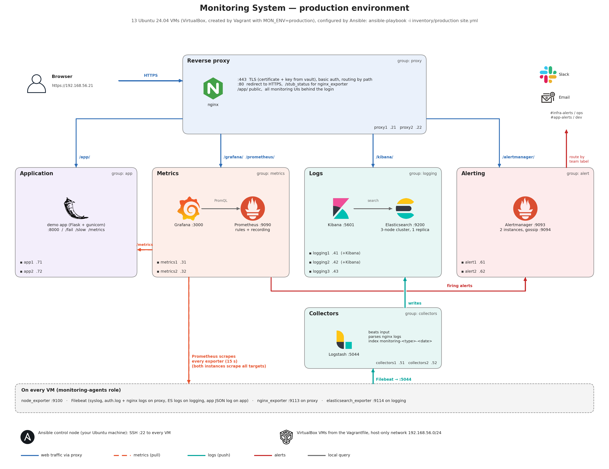

# Monitoring System

Ansible automation of a complete monitoring and logging platform. One
playbook takes clean Ubuntu 24.04 machines to a working system with metrics,
dashboards, alerting, centralized logs and a reverse proxy, and a small web
application that the platform monitors.

Project 5 (*DevOps monitoring platform*)

| Area | Components |
|------|------------|
| Metrics and alerting | Prometheus, Grafana, Alertmanager, node_exporter, nginx and Elasticsearch exporters |
| Logs | Filebeat, Logstash, Elasticsearch, Kibana |
| Access | nginx reverse proxy with TLS and basic authentication |
| Monitored workload | demo application (Flask, gunicorn) |

## Architecture



The platform is split into six tiers. Each tier is an inventory group and runs
on its own virtual machines:

| Tier | Group | Components | Staging | Production |
|------|-------|------------|---------|------------|
| Reverse proxy | `proxy` | nginx, nginx_exporter | 1 host | 2 hosts |
| Metrics | `metrics` | Prometheus, Grafana | 1 host | 2 hosts |
| Logs | `logging` | Elasticsearch, Kibana, elasticsearch_exporter | 1 host | 3 hosts |
| Log collectors | `collectors` | Logstash | 1 host | 2 hosts |
| Alerting | `alert` | Alertmanager | 1 host | 2 hosts |
| Application | `app` | demo application | 1 host | 2 hosts |
| All hosts | `monitoring` | node_exporter, Filebeat | | |

- **Web access:** users reach every interface through nginx over HTTPS. nginx
  checks the login and forwards by path to Grafana, Prometheus, Alertmanager,
  Kibana or the application. The application is public; the monitoring
  interfaces require a login.
- **Metrics:** Prometheus scrapes node_exporter on every host, the service
  exporters, Alertmanager and the application every 15 seconds. Targets are
  generated from the inventory. Grafana visualizes the data.
- **Logs:** Filebeat on every host sends system, nginx, Elasticsearch and
  application logs to Logstash, which parses them and stores them in
  Elasticsearch. Kibana is used to search them.
- **Alerts:** Prometheus evaluates alert rules and sends firing alerts to
  Alertmanager, which notifies through Slack and email.

Every metric, alert and log line carries a `team` label (`infra` or `app`).
Alertmanager routes on it, so infrastructure and application alerts reach
different receivers; Grafana and Kibana have separate folders and data views
for both.

Staging and production use the same playbooks and roles; only the inventory
differs. Production adds high availability: a 3-node Elasticsearch cluster
with replicas, two clustered Alertmanagers, two independent Prometheus
instances, and two of every other tier. A diagram of the staging environment
is in [docs/architecture-staging.png](docs/architecture-staging.png).

## Repository structure

```
├── site.yml                 full deployment
├── rolling_update.yml       zero-downtime update of the application tier
├── ansible.cfg              Ansible settings
├── requirements.txt         ansible-core version
├── requirements.yml         Galaxy roles and collections
├── Vagrantfile              virtual machines of both environments
├── templates/               nginx upstreams template, shared by both playbooks
├── inventory/
│   ├── staging/             6 hosts (default)
│   └── production/          13 hosts
├── roles/
│   ├── monitoring-agents/   node_exporter, Filebeat, exporters per group
│   ├── prometheus-config/   scrape targets, alert and recording rules
│   ├── grafana-dashboards/  data source, dashboards, authentication
│   ├── elk-pipeline/        Elasticsearch, Logstash, Kibana, Filebeat configuration
│   └── demo-app/            the monitored application
└── docs/                    playbook documentation, demonstration scenarios, diagrams
```

Galaxy roles install the software, the custom roles configure it:
`prometheus.prometheus` (Prometheus, Alertmanager, node_exporter),
`grafana.grafana`, `geerlingguy.elasticsearch` and `geerlingguy.nginx`.

## Getting started

### Prerequisites

- Ubuntu 24.04 host with hardware virtualization enabled
- [VirtualBox](https://www.virtualbox.org/wiki/Linux_Downloads) 7.2.8 or newer,
  from Oracle's repository (Ubuntu's own package does not support the newer
  24.04 kernels)
- [Vagrant](https://developer.hashicorp.com/vagrant/install) 2.4.9 or newer,
  from HashiCorp's repository
- Python 3.12, Git
- Free memory: about 7 GB for staging, 10.5 GB for production (one
  environment runs at a time)

### Setup

```bash
git clone https://github.com/SretenGlavinceski/Monitoring-System.git
cd Monitoring-System

python3 -m venv .venv
source .venv/bin/activate
pip install -r requirements.txt
ansible-galaxy install -r requirements.yml

echo 'the-vault-password' > .vault_pass
chmod 600 .vault_pass
```

The vault password is not part of the repository; see [Ansible Vault](#ansible-vault).

### Deploy

```bash
# staging
vagrant up
ansible-playbook site.yml

# production
MON_ENV=production vagrant up
ansible-playbook -i inventory/production site.yml
```

### Access

| Interface | Staging | Production |
|-----------|---------|------------|
| Grafana | https://192.168.56.10/grafana/ | https://192.168.56.21/grafana/ |
| Prometheus | https://192.168.56.10/prometheus/ | https://192.168.56.21/prometheus/ |
| Alertmanager | https://192.168.56.10/alertmanager/ | https://192.168.56.21/alertmanager/ |
| Kibana | https://192.168.56.10/kibana/ | https://192.168.56.21/kibana/ |
| Application | https://192.168.56.10/app/ | https://192.168.56.21/app/ |

The certificate is self-signed. The monitoring interfaces use the user `admin`
and the proxy password from the vault; Grafana additionally asks for its own
admin login.

## Ansible Vault

Each environment keeps its secrets in `inventory/<env>/group_vars/all/vault.yml`,
encrypted with Ansible Vault:

| Secret | Used for |
|--------|----------|
| `vault_grafana_admin_password` | Grafana admin login |
| `vault_proxy_basic_auth_password` | nginx login in front of the monitoring interfaces |
| `vault_slack_webhook_infra`, `vault_slack_webhook_app` | Slack notifications |
| `vault_smtp_password` | email notifications |
| `vault_tls_private_key` | private key of the proxy's TLS certificate |

The plain file `group_vars/all/vars.yml` maps each secret to the name the
roles use, for example
`grafana_admin_password: "{{ vault_grafana_admin_password }}"`, so the
repository shows which secrets exist without revealing them. During a run
Ansible reads the password from `.vault_pass` (configured in `ansible.cfg`)
and decrypts the files in memory.

**Local setup.** Store the vault password in `.vault_pass` as shown in
[Setup](#setup). The file is excluded by `.gitignore`.

**Working with the vault:**

```bash
ansible-vault view inventory/staging/group_vars/all/vault.yml     # show
ansible-vault edit inventory/staging/group_vars/all/vault.yml     # change, re-encrypts on save
ansible-vault rekey inventory/*/group_vars/all/vault.yml          # new vault password
```

**New vault from scratch.** Write the values in plain YAML to both
`vault.yml` files, then encrypt them before committing:

```bash
ansible-vault encrypt inventory/staging/group_vars/all/vault.yml
ansible-vault encrypt inventory/production/group_vars/all/vault.yml
```

## Common commands

| Command | Purpose |
|---------|---------|
| `vagrant up` / `vagrant halt` | start / stop the staging machines |
| `vagrant destroy -f && vagrant up` | recreate them from a clean image |
| `vagrant status` | state of the machines |
| `ansible all -m ping` | check connectivity |
| `ansible-playbook site.yml` | deploy or update everything |
| `ansible-playbook site.yml --limit app` | deploy one group only |
| `ansible-playbook site.yml --check` | show what would change, change nothing |
| `ansible-playbook -i inventory/production rolling_update.yml -e app_version=1.1.0` | deploy a new application version without downtime |

Add `MON_ENV=production` to Vagrant commands and `-i inventory/production` to
Ansible commands for production. A repeated run of `site.yml` reports
`changed=0`.

## Documentation

| Document | Content |
|----------|---------|
| [docs/site.md](docs/site.md) | every play of `site.yml`, `ansible.cfg` |
| [docs/rolling_update.md](docs/rolling_update.md) | the rolling update, step by step |
| [docs/demo.md](docs/demo.md) | demonstration scenarios for every service |
| [inventory/README.md](inventory/README.md) | inventory layout and variable precedence |
| [inventory/staging/README.md](inventory/staging/README.md) | staging hosts and settings |
| [inventory/production/README.md](inventory/production/README.md) | production hosts and settings |
| [templates/README.md](templates/README.md) | nginx upstreams template |
| [roles/monitoring-agents](roles/monitoring-agents/README.md) | agents on every host |
| [roles/prometheus-config](roles/prometheus-config/README.md) | Prometheus configuration and rules |
| [roles/grafana-dashboards](roles/grafana-dashboards/README.md) | Grafana provisioning |
| [roles/elk-pipeline](roles/elk-pipeline/README.md) | log pipeline |
| [roles/demo-app](roles/demo-app/README.md) | the monitored application |

## Requirements coverage

| Requirement | Implementation |
|-------------|----------------|
| Full automation with one command | `site.yml` |
| `roles/`, `inventory/`, `group_vars/`, `host_vars/` | see [Repository structure](#repository-structure) |
| Custom roles (at least 3) | 5 roles in `roles/` |
| Ansible Vault | [Ansible Vault](#ansible-vault) |
| Idempotency | a repeated run reports `changed=0` |
| Handlers, Jinja2 templates | in every role |
| Staging and production inventories | `inventory/staging`, `inventory/production` |
| prometheus-config, grafana-dashboards, elk-pipeline, monitoring-agents | roles of the same names |
| Fact caching, agents with `serial: 20%` | [docs/site.md](docs/site.md) |
| Rolling update with `serial`, `delegate_to`, health check | [docs/rolling_update.md](docs/rolling_update.md) |